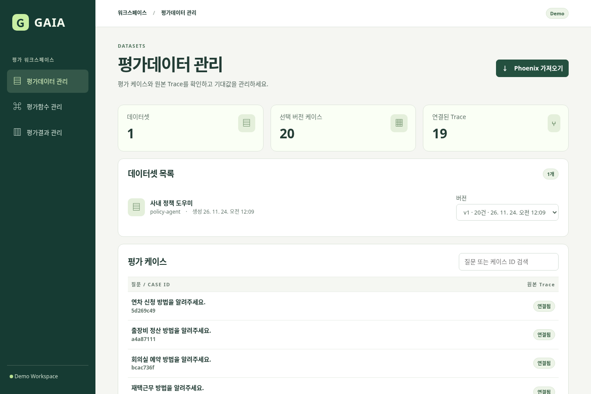

# 평가 워크스페이스 사용법

## 데이터 준비

1. 평가데이터 관리의 **Phoenix 가져오기**에서 원본과 버전을 고릅니다. 미리보기에는 대상 수와 질문이 표시됩니다. 기본 Fixture는 한국어 사내 정책 질문 20건입니다.
2. 목록에서 Dataset 버전을 고르고 질문이나 ID로 케이스를 검색하세요. 마지막 합성 케이스에는 Trace 미연결 경고가 있습니다.
3. 케이스를 클릭해 기존 응답, 문서, Tool, 원본 데이터를 확인합니다. 입력·기대 응답·기대 동작은 JSON으로 편집합니다. 텍스트는 큰따옴표로 감싸세요. **새 버전 저장**을 누르면 이전 버전과 실험을 계속 열 수 있습니다.

## 평가함수 정의

1. 평가함수 관리에서 엔진·범주·단위·기대값·모델 사용 여부로 지표를 찾으세요. **Exact Match**는 기대 응답과 실제 문자열 일치를 비교합니다. **Tool Correctness**는 호출 도구 이름을 비교합니다.
2. 선택 / 설정을 누른 뒤 왼쪽에서 이름과 기준을 정합니다. 오른쪽에서 실제 샘플을 선택하고 JSON 필드를 펼친 뒤 **이 경로 선택**으로 현재 변수에 연결하세요. 다른 질문으로 전환해 같은 규칙을 확인할 수 있습니다.
3. 복수 검색 단계가 있으면 **변수 경로 설정**에서 Span 조건과 선택 정책을 지정하세요. 추천 기본값은 공통 입력명과 `text` 필드 경로에서 생성됩니다.
4. **매핑 미리보기**에서 타입·길이·실제 경로·정규화 값을 확인합니다. **전체 검증**은 통과 수와 누락·타입 오류가 있는 케이스를 보여줍니다. **시험 평가**는 샘플 한 건에 실제 엔진을 호출합니다.
5. **버전 발행**을 누르세요. 기존 발행본을 선택해 수정하면 같은 family의 새 정의와 매핑이 발행됩니다. 모델 지표는 Judge 설정이 필요하며, 평가 과정에서 추출된 데이터가 모델로 전송됩니다.

## 실험과 회귀 분석

1. 평가결과 관리 → 평가 실행에서 Dataset 버전, 방식, 이름, Evaluator 복수 선택을 확인합니다. 실행 전 매핑 검증은 가져온 Trace를 대상으로 하며 신규 실행의 필드 구조는 달라질 수 있습니다.
2. **기존 결과 평가**는 Phoenix 실행 또는 같은 Dataset의 완료 실험을 재사용합니다. **신규 실행 평가**는 선택 환경에 케이스 입력을 HTTP로 보냅니다. **A/B 비교 평가**는 같은 매핑으로 A(Mock PRD)와 B(Mock STG)를 실행합니다.
3. 이력에서 실험을 선택하면 진행 수, 점수가 있는 결과 수, 지표별 평균, 분포와 실행 지연 시간이 나옵니다. 케이스 상세에서 원문과 지표별 reason·실제 입력·경로를 확인하세요.
4. 대기 건 취소는 이미 처리 중인 케이스를 마무리합니다. 실행/엔진 오류는 전체 또는 케이스 단위로 재시도할 수 있습니다. 낮은 점수·검색 문서 부재·도구 오류 필터는 원본 확인을 돕습니다. 문서 부재만으로 근본 원인을 단정할 수 없습니다.
5. 실험 비교에서 기준 A와 후보 B를 고르세요. Dataset 또는 평가 정의·매핑 버전이 다르면 비교가 차단됩니다. **회귀만 보기**에서 각 질문의 양측 응답, 문서, 도구 경로, 판정 근거를 펼쳐 확인하세요. Δ는 B 점수에서 A 점수를 뺀 값입니다.
